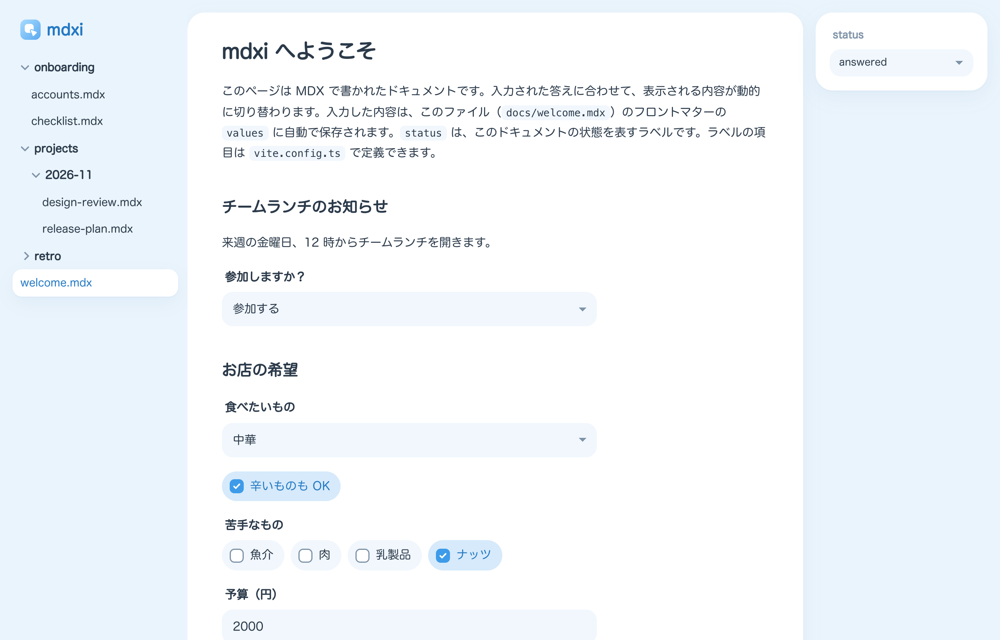

<div align="center">
  
  <h1>mdxi</h1>
  <p>MDX Interactive</p>
</div>

AI エージェントがユーザー向けの UI を MDX で書き、ユーザーがブラウザで入力するためのツール。入力した値はドキュメントのフロントマターに保存され、エージェントはそれを読んで作業を進める。



仕様は [SPEC.md](./SPEC.md)。

## 使い方

```sh
npm create mdxi my-docs
cd my-docs
npm install
npm run dev     # http://localhost:5173/welcome.mdx
```

詳しくは [packages/mdxi/README.md](./packages/mdxi/README.md)。

## リポジトリの構成

| ディレクトリ | 内容 |
|---|---|
| `packages/mdxi` | Vite プラグイン（`mdxi/vite`）、標準コンポーネント（`mdxi/components`）、`useField`（`mdxi`）、CLI（`mdxi check`） |
| `packages/create-mdxi` | `npm create mdxi <dir>` のテンプレート（エージェント向けの Skill を含む） |
| `examples/basic` | テンプレートと同じ内容のサンプル（`mdxi` はワークスペースのもの） |
| `scripts/e2e.mjs` | ブラウザ（Chrome）での E2E |

## 開発

```sh
pnpm install
pnpm build        # packages/mdxi をビルド
pnpm test         # ユニットテスト
pnpm typecheck
```

サンプルを動かす:

```sh
cd examples/basic
pnpm dev
pnpm check
```

E2E（dev server を起動した状態で実行する。ローカルの Chrome を使う）:

```sh
cd examples/basic && pnpm dev --port 5199 &
node scripts/e2e.mjs 5199 examples/basic
```

テンプレート（`packages/create-mdxi/template`）を変えたら、`examples/basic` にも同じ変更を入れる。
